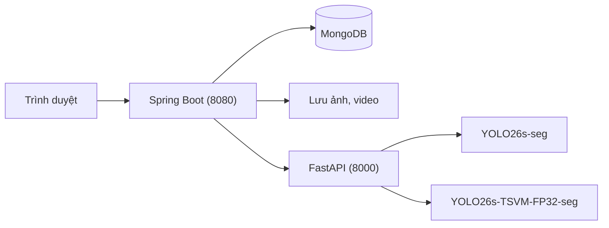

# PolypVision

> **Đề tài:** “Nghiên cứu phương pháp tích hợp VMamba vào mô hình YOLO26-seg trong phân đoạn polyp từ ảnh nội soi đại trực tràng.” (CNTT-KLCN182)

> **Mã nguồn nghiên cứu** (dữ liệu, huấn luyện, số liệu, báo cáo): <https://github.com/Okeydokey8525/KLCN183>.

PolypVision là website phục vụ nghiên cứu phân đoạn polyp trên ảnh nội soi đại trực tràng. Website cho phép chạy và so sánh mô hình gốc `YOLO26s-seg` với mô hình đề xuất `YOLO26s-TSVM-FP32-seg` (YOLO26s-seg + C2TSVMamba) trên ảnh và video.

> **Cảnh báo:** PolypVision không phải thiết bị y tế và không cung cấp chẩn đoán lâm sàng.

## 1. Nhóm thực hiện

| MSSV | Họ và tên |
|---|---|
| 2001230490 | Lê Đức Lương |
| 2001230312 | Phùng Tuấn Huy |
| 2001230830 | Trần Mạnh Toàn |

- Giảng viên hướng dẫn: **TS. Phùng Thế Bảo**, [baopt@huit.edu.vn](mailto:baopt@huit.edu.vn)
- Đơn vị: Trường Đại học Công Thương TP. Hồ Chí Minh, Khoa Công nghệ Thông tin

## 2. Kiến trúc



- Spring Boot quản lý tài khoản, phiên đăng nhập, CSRF, lịch sử, trang quản trị, MongoDB và file ảnh.
- FastAPI chỉ suy luận, không lưu lịch sử hay ảnh lâu dài.

## 3. Mô hình

| Model key | Vai trò | Checkpoint |
|---|---|---|
| `YOLO26s-seg` | Mô hình gốc | `polypweb/ai-service/models/yolo26s-seg-best.pt` |
| `YOLO26s-TSVM-FP32-seg` | Mô hình đề xuất | `polypweb/ai-service/models/yolo26s-tsvm-fp32-best.pt` |

- Mô hình đề xuất thay `C2PSA` ở tầng 10 bằng khối `C2TSVMamba`: SS2D quét bốn hướng, nhánh hình dạng đa tỉ lệ có hướng, cổng `F_M * (1 + G)` và residual scaling. Mã khối nằm ở `polypweb/ai-service/custom_ultralytics/`.
- Hai checkpoint lấy từ **seed 15** của thực nghiệm 20 seed, cùng seed cho cả hai mô hình. Seed 15 được chọn vì chênh lệch mask mAP50–95 giữa hai mô hình gần trung vị 20 seed nhất (+0,0037 so với trung vị +0,0039).
- `models/experiment_manifest.json` ghi nguồn và SHA-256 của hai checkpoint.
- Ứng dụng ép mô hình về float32 và suy luận với `half=False`.

## 4. Công nghệ

| Thành phần | Công nghệ |
|---|---|
| Web | Java 17, Spring Boot 4.1, Spring MVC, Thymeleaf, Spring Security, Spring Data MongoDB, Actuator, Bootstrap 5 |
| Dịch vụ AI | Python, FastAPI, Uvicorn, Ultralytics, PyTorch, OpenCV, NumPy |
| CSDL | MongoDB, lưu file cục bộ |

## 5. Cấu trúc repository

```text
.
├── README.md
├── co_so_du_lieu/            # Mô tả CSDL MongoDB, script khởi tạo, dữ liệu xuất mẫu
│   ├── MO_TA_CSDL.md
│   ├── khoi_tao_csdl.js
│   └── du_lieu_xuat/
└── polypweb/                 # Website Spring Boot
    ├── src/
    ├── ai-service/           # Dịch vụ AI FastAPI
    │   ├── custom_ultralytics/
    │   ├── models/           # Hai checkpoint seed 15
    │   ├── tests/
    │   └── main.py
    ├── pom.xml
    └── README.md
```

Không có trong repo: `.venv`, `target/`, `storage/` (ảnh và video người dùng tải lên khi chạy thử).

## 6. Tính năng

- Đăng ký, đăng nhập, đăng xuất; hai vai trò `USER` và `ADMIN`.
- Dashboard theo tài khoản và dashboard quản trị.
- Phân tích một ảnh bằng mô hình gốc hoặc mô hình đề xuất.
- So sánh hai mô hình trên cùng một ảnh.
- Phân tích video ngoại tuyến (MP4, AVI, MOV, MKV, WEBM; tối đa 200 MB, 5 phút, 9.000 khung). Chọn 2, 5, 10 khung/giây, hoặc tất cả khung khi FastAPI chạy GPU. Có dòng thời gian các khung có polyp và chế độ mô phỏng thời gian thực.
- Trang `/metrics` hiển thị kết quả thực nghiệm 20 seed.
- Lưu ảnh gốc, lớp phủ và metadata; lịch sử có tìm kiếm, lọc, phân trang.
- Hồ sơ, đổi mật khẩu, quản lý tài khoản và vai trò.
- Spring Security, CSRF, BCrypt và các security header.

Tài liệu chi tiết: [polypweb/README.md](polypweb/README.md), [polypweb/ai-service/README.md](polypweb/ai-service/README.md).

## 7. Yêu cầu môi trường

- Java 17.
- MongoDB chạy ở `localhost:27017`.
- Python 3.12 và thư viện trong `polypweb/ai-service/requirements.txt`.
- GPU không bắt buộc; CPU vẫn chạy được nhưng chậm hơn.

## 8. Cách chạy

Thứ tự khởi động: MongoDB → FastAPI → Spring Boot.

**MongoDB:** website tự tạo collection khi chạy lần đầu. Muốn tạo sẵn cấu trúc thì chạy:

```powershell
mongosh "mongodb://localhost:27017/polypweb" co_so_du_lieu\khoi_tao_csdl.js
```

**FastAPI:**

```powershell
cd polypweb\ai-service
python -m venv .venv
.\.venv\Scripts\python.exe -m pip install -r requirements.txt
.\.venv\Scripts\python.exe -m uvicorn main:app --host 127.0.0.1 --port 8000
```

Mở `http://127.0.0.1:8000/health` để kiểm tra hai mô hình đã sẵn sàng.

**Spring Boot:**

```powershell
cd polypweb
$env:SPRING_PROFILES_ACTIVE="dev"
.\mvnw.cmd spring-boot:run
```

Mở `http://localhost:8080`, đăng ký tài khoản ở `/register` rồi đăng nhập.

## 9. Biến môi trường

### FastAPI

| Biến | Mặc định | Vai trò |
|---|---|---|
| `AI_BASELINE_MODEL_PATH` | `models/yolo26s-seg-best.pt` | Checkpoint mô hình gốc |
| `AI_VMAMBA_MODEL_PATH` | `models/yolo26s-tsvm-fp32-best.pt` | Checkpoint mô hình đề xuất |
| `AI_DEVICE` | `auto` | `cpu`, `cuda:0` hoặc tự động |
| `AI_CONFIDENCE_THRESHOLD` | `0.25` | Ngưỡng confidence |
| `AI_IMAGE_SIZE` | `640` | Kích thước ảnh suy luận |
| `AI_VIDEO_MAX_MB`, `AI_VIDEO_MAX_SECONDS`, `AI_VIDEO_MAX_FRAMES` | 200, 300, 9000 | Giới hạn video |

### Spring Boot

| Biến | Mục đích |
|---|---|
| `SPRING_PROFILES_ACTIVE` | `dev` hoặc `prod` |
| `POLYPVISION_MONGODB_URI` | MongoDB URI |
| `POLYPVISION_AI_BASE_URL` | Địa chỉ FastAPI |
| `POLYPVISION_STORAGE_ROOT` | Thư mục lưu ảnh, video |
| `POLYPVISION_ADMIN_EMAIL`, `POLYPVISION_ADMIN_PASSWORD`, `POLYPVISION_ADMIN_NAME` | Tạo sẵn tài khoản admin (tùy chọn, không commit mật khẩu) |

Profile `prod` bắt buộc có `POLYPVISION_MONGODB_URI` và `POLYPVISION_AI_BASE_URL`.

## 10. Kiểm thử

```powershell
cd polypweb\ai-service
.\.venv\Scripts\python.exe -m pip install -r requirements-dev.txt
.\.venv\Scripts\python.exe -m pytest -q

cd ..
.\mvnw.cmd test
```

## 11. Giới hạn

- Video chỉ xử lý từ tệp đã ghi, chưa nhận luồng trực tiếp từ máy nội soi; mỗi khung được phân tích độc lập.
- Chưa có triển khai HTTPS và giới hạn tần suất gọi API cho môi trường thật.
- Lưu file cục bộ, chưa dùng object storage.
- Thời gian xử lý hiển thị trên web phụ thuộc máy và mạng, không phải benchmark khoa học.
- Chưa có đánh giá của bác sĩ nội soi.

> Kết quả chỉ phục vụ nghiên cứu và tham khảo, không thay thế chẩn đoán của bác sĩ.
