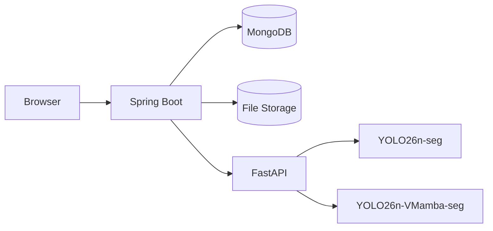

# PolypVision

> **Đề tài:** “Nghiên cứu phương pháp tích hợp VMamba vào mô hình YOLO26-seg trong phân đoạn polyp từ ảnh nội soi đại trực tràng.”

PolypVision là ứng dụng web phục vụ nghiên cứu phân đoạn polyp từ ảnh nội soi đại trực tràng. Hệ thống hỗ trợ chạy riêng mô hình `YOLO26n-seg` hoặc `YOLO26n-VMamba-seg`, so sánh hai mô hình trên cùng một ảnh, lưu lịch sử và quản lý kết quả theo từng tài khoản.

PolypVision **không phải thiết bị y tế** và không thay thế chẩn đoán, tư vấn hoặc đánh giá của bác sĩ.

## Mục lục

- [Thông tin dự án](#thong-tin-du-an)
- [Tính năng chính](#tinh-nang-chinh)
- [Kiến trúc hệ thống](#kien-truc-he-thong)
- [Công nghệ sử dụng](#cong-nghe-su-dung)
- [Cấu trúc thư mục](#cau-truc-thu-muc)
- [Yêu cầu hệ thống](#yeu-cau-he-thong)
- [Chuẩn bị checkpoint](#chuan-bi-checkpoint)
- [Cài đặt MongoDB](#cai-dat-mongodb)
- [Cài đặt và chạy FastAPI](#cai-dat-fastapi)
- [Chạy Spring Boot ở development](#chay-development)
- [Tạo tài khoản ADMIN](#tao-admin)
- [Biến môi trường](#bien-moi-truong)
- [Chạy production](#chay-production)
- [URL chức năng](#url-chuc-nang)
- [Quy trình sử dụng](#quy-trinh-su-dung)
- [Lưu trữ ảnh](#luu-tru-anh)
- [Bảo mật](#bao-mat)
- [Health và giám sát](#health-va-giam-sat)
- [Kiểm thử và đóng gói](#kiem-thu)
- [Xử lý lỗi thường gặp](#xu-ly-loi)
- [Dữ liệu và quyền riêng tư](#du-lieu-va-quyen-rieng-tu)
- [Giới hạn hiện tại](#gioi-han-hien-tai)
- [Không commit các dữ liệu sau](#khong-commit)
- [Cảnh báo nghiên cứu](#canh-bao-nghien-cuu)

<a id="thong-tin-du-an"></a>
## Thông tin dự án

### Nhóm thực hiện

| MSSV | Họ và tên |
|---|---|
| 2001230490 | Lê Đức Lương |
| 2001230312 | Phùng Tuấn Huy |
| 2001230830 | Trần Mạnh Toàn |

### Giảng viên hướng dẫn

- **TS. Phùng Thế Bảo**
- Email: [baopt@huit.edu.vn](mailto:baopt@huit.edu.vn)

### Đơn vị

- Trường Đại học Công Thương TP. Hồ Chí Minh
- Khoa Công nghệ Thông tin

<a id="tinh-nang-chinh"></a>
## Tính năng chính

### Tài khoản và bảo mật

- Đăng ký, đăng nhập và đăng xuất.
- Hai vai trò `USER` và `ADMIN`.
- Mật khẩu được băm bằng BCrypt.
- CSRF, session authentication và phân quyền theo route.
- Ownership dữ liệu theo MongoDB user ID.
- Hồ sơ cá nhân và đổi mật khẩu.
- Quản trị tài khoản, khóa/mở khóa và đổi vai trò.

### Phân tích và so sánh mô hình

- Phân tích ảnh bằng `YOLO26n-seg`.
- Phân tích ảnh bằng `YOLO26n-VMamba-seg`.
- So sánh hai mô hình trên cùng một ảnh.
- Hiển thị mask/overlay, nhãn, confidence, số mask và thời gian xử lý.
- Lưu ảnh gốc, ảnh kết quả và metadata.
- Không tạo lịch sử sai khi inference thất bại.

### Lịch sử và xuất dữ liệu

- Lịch sử phân tích đơn và lịch sử so sánh.
- Phân trang, tìm kiếm, lọc model, lọc detected/not detected và lọc theo ngày.
- Sắp xếp kết quả.
- Tải ảnh gốc, tải overlay và xuất metadata JSON.
- Dữ liệu được giới hạn theo tài khoản sở hữu.

### Dashboard và giao diện

- Dashboard dành cho `USER` và `ADMIN`.
- Hiển thị hoạt động sử dụng, trạng thái FastAPI và trạng thái model.
- Giao diện responsive.
- Chế độ sáng, tối hoặc theo hệ thống.
- Hỗ trợ accessibility và reduced motion.
- Trang Privacy Policy, Terms of Use và Research Disclaimer.
- Spring Boot health endpoint và logging có request ID.

> Các số liệu dashboard mô tả hoạt động sử dụng hệ thống. Chúng không phải mAP, Dice, IoU hoặc kết luận về độ chính xác khoa học của mô hình.

<a id="kien-truc-he-thong"></a>
## Kiến trúc hệ thống



### Vai trò của từng thành phần

**Spring Boot**

- Cung cấp giao diện Thymeleaf.
- Quản lý Spring Security, tài khoản, session và ownership.
- Quản lý lịch sử, dashboard, download và export.
- Lưu ảnh vào storage và metadata vào MongoDB.
- Gửi ảnh multipart tới FastAPI.

**FastAPI**

- Tải checkpoint khi service khởi động và giữ model trong bộ nhớ.
- Kiểm tra nội dung ảnh, chọn model và chạy inference.
- Trả metadata cùng ảnh overlay ở dạng Base64 cho Spring Boot.
- Không quản lý lịch sử hoặc storage lâu dài.

**MongoDB**

- Collection `users`: tài khoản và vai trò.
- Collection `diagnosis_history`: metadata phân tích đơn và so sánh.

**File Storage**

- `storage/original`: ảnh gốc.
- `storage/results`: ảnh overlay.

<a id="cong-nghe-su-dung"></a>
## Công nghệ sử dụng

| Nhóm | Công nghệ |
|---|---|
| Backend web | Java 17, Spring Boot 4.1, Spring Security, Spring Data MongoDB, Spring Boot Actuator, Thymeleaf, Maven |
| AI service | Python 3.12 trong môi trường hiện tại, FastAPI, Uvicorn, PyTorch, Ultralytics, custom VMambaBlock |
| Frontend | HTML, CSS, Bootstrap 5, JavaScript thuần, Thymeleaf |
| Database | MongoDB |
| Model | YOLO26n-seg, YOLO26n-VMamba-seg |

<a id="cau-truc-thu-muc"></a>
## Cấu trúc thư mục

```text
polypweb/
├── ai-service/
│   ├── main.py
│   ├── requirements.txt
│   ├── models/
│   ├── custom_ultralytics/
│   └── .venv/
├── src/
│   ├── main/
│   │   ├── java/
│   │   └── resources/
│   │       ├── templates/
│   │       ├── static/
│   │       ├── application.properties
│   │       ├── application-dev.properties
│   │       └── application-prod.properties
│   └── test/
├── storage/
│   ├── original/
│   └── results/
├── pom.xml
├── mvnw
├── mvnw.cmd
└── README.md
```

- `ai-service/`: dịch vụ inference Python và custom module cần cho VMamba.
- `src/main/java/`: controller, service, repository, security, health và cấu hình Spring.
- `src/main/resources/templates/`: giao diện Thymeleaf.
- `src/main/resources/static/`: CSS và JavaScript.
- `src/test/`: test unit và integration.
- `storage/`: ảnh runtime, không nằm trong static.

<a id="yeu-cau-he-thong"></a>
## Yêu cầu hệ thống

- Windows 10/11 hoặc hệ điều hành tương đương.
- Java 17.
- Python 3.12 được khuyến nghị để khớp môi trường hiện tại; `.venv` đang được tạo bằng Python 3.12.13.
- MongoDB đang hoạt động.
- Maven Wrapper đã có sẵn, không bắt buộc cài Maven toàn cục.
- Trình duyệt hiện đại.
- Hai checkpoint model đúng tên.
- Dung lượng lưu trữ đủ cho ảnh gốc và overlay.
- GPU là tùy chọn. CPU vẫn chạy được nhưng inference có thể chậm hơn đáng kể.

> Khả năng cài PyTorch/GPU còn phụ thuộc hệ điều hành, driver và CUDA. Kiểm tra hướng dẫn chính thức của PyTorch nếu cần môi trường GPU.

<a id="chuan-bi-checkpoint"></a>
## Chuẩn bị checkpoint

Model registry trong `ai-service/main.py` mặc định tìm hai file:

```text
ai-service/
└── models/
    ├── yolo26n-seg-best.pt
    └── yolo26n-vmamba-seg-best.pt
```

Lưu ý:

- Checkpoint `.pt` được ignore và không nhất thiết có trong Git; cần sao chép thủ công khi chuyển máy.
- VMamba checkpoint cần module tương ứng trong `ai-service/custom_ultralytics/`.
- Không đổi tên checkpoint nếu chưa cập nhật model registry.
- Không commit checkpoint nếu chưa có quy định lưu trữ phù hợp.
- Sau khi đặt file, khởi động FastAPI và kiểm tra `/health`.

FastAPI cũng hỗ trợ override đường dẫn bằng biến môi trường:

- `AI_BASELINE_MODEL_PATH`: checkpoint baseline.
- `AI_MODEL_PATH`: fallback tương thích cho checkpoint baseline.
- `AI_VMAMBA_MODEL_PATH`: checkpoint VMamba.

Không đặt đường dẫn tuyệt đối của máy cá nhân vào source hoặc README.

<a id="cai-dat-mongodb"></a>
## Cài đặt MongoDB

1. Cài MongoDB phù hợp với hệ điều hành.
2. Khởi động MongoDB service.
3. Với profile `dev`, URI mặc định là:

```text
mongodb://localhost:27017/polypweb
```

Không cần tạo collection thủ công. Khi ứng dụng hoạt động:

- Spring Data MongoDB sử dụng `users` và `diagnosis_history`.
- `UserAccountIndexInitializer` tạo unique index cho email.
- `DiagnosisHistoryIndexInitializer` tạo các index phục vụ lịch sử, model, detected và comparison group.

Có thể kiểm tra MongoDB bằng:

```powershell
mongosh
```

Sau đó:

```javascript
show dbs
```

Không dùng lệnh xóa database trên dữ liệu thật.

<a id="cai-dat-fastapi"></a>
## Cài đặt và chạy FastAPI

Các dependency Python đã được khóa phiên bản trong `ai-service/requirements.txt`.

### Tạo môi trường Python trên Windows

```powershell
cd ai-service
python -m venv .venv
.\.venv\Scripts\Activate.ps1
python -m pip install --upgrade pip
pip install -r requirements.txt
```

Nếu PowerShell không cho phép activate script, vẫn có thể gọi trực tiếp Python trong `.venv` ở các lệnh tiếp theo.

### Chạy FastAPI

```powershell
cd ai-service
.\.venv\Scripts\python.exe -m uvicorn main:app --host 127.0.0.1 --port 8000
```

Kiểm tra:

```text
http://127.0.0.1:8000/health
```

Kết quả health cần cho thấy:

- FastAPI có thể truy cập.
- Baseline ở trạng thái ready.
- VMamba ở trạng thái ready.

Nếu một checkpoint hoặc custom module lỗi, health sẽ báo trạng thái suy giảm thay vì âm thầm dùng model khác.

<a id="chay-development"></a>
## Chạy Spring Boot ở development

### Thứ tự khởi động

1. MongoDB.
2. FastAPI.
3. Spring Boot.
4. Mở trình duyệt.

### Lệnh PowerShell

Từ thư mục dự án:

```powershell
cd "<thu-muc-du-an>"
$env:SPRING_PROFILES_ACTIVE="dev"
.\mvnw.cmd spring-boot:run
```

Giá trị mặc định của profile `dev`:

| Thành phần | Giá trị |
|---|---|
| MongoDB | `mongodb://localhost:27017/polypweb` |
| FastAPI trong cấu hình Spring | `http://localhost:8000` |
| FastAPI khi chạy bằng lệnh ở trên | `http://127.0.0.1:8000` |
| Storage | `storage` |
| Website | `http://localhost:8080` |

`localhost:8000` của Spring kết nối tới service đang bind tại `127.0.0.1:8000` trên máy local.

<a id="tao-admin"></a>
## Tạo tài khoản ADMIN

Đặt đủ ba biến môi trường trước khi khởi động Spring Boot:

```powershell
$env:POLYPVISION_ADMIN_EMAIL="admin@example.com"
$env:POLYPVISION_ADMIN_PASSWORD="<mật khẩu tự đặt>"
$env:POLYPVISION_ADMIN_NAME="Administrator"

$env:SPRING_PROFILES_ACTIVE="dev"
.\mvnw.cmd spring-boot:run
```

Cơ chế seed admin:

- Chỉ chạy khi có đủ email, password và tên.
- Chỉ tạo khi email chưa tồn tại.
- Mật khẩu được băm bằng BCrypt trước khi lưu.
- Không lưu mật khẩu trong source hoặc `application*.properties`.
- Sau khi seed xong, có thể xóa biến password khỏi phiên PowerShell:

```powershell
Remove-Item Env:POLYPVISION_ADMIN_PASSWORD
```

Không commit password vào README, script hoặc lịch sử Git.

<a id="bien-moi-truong"></a>
## Biến môi trường

| Tên | Bắt buộc ở dev | Bắt buộc ở prod | Giá trị mặc định | Mô tả |
|---|:---:|:---:|---|---|
| `SPRING_PROFILES_ACTIVE` | Không | Có | `dev` | Chọn profile `dev` hoặc `prod`. |
| `POLYPVISION_MONGODB_URI` | Không | Có | Dev: `mongodb://localhost:27017/polypweb`; prod: không có | URI MongoDB. |
| `POLYPVISION_AI_BASE_URL` | Không | Có | Dev: `http://localhost:8000`; prod: không có | Base URL FastAPI. |
| `POLYPVISION_STORAGE_ROOT` | Không | Không | `storage` | Thư mục storage; production nên dùng vị trí bền vững. |
| `POLYPVISION_AI_CONNECT_TIMEOUT` | Không | Không | `3s` | Timeout thiết lập kết nối FastAPI. |
| `POLYPVISION_AI_READ_TIMEOUT` | Không | Không | `15s` | Timeout chờ inference. |
| `POLYPVISION_AI_HEALTH_TIMEOUT` | Không | Không | `2s` | Timeout kiểm tra FastAPI health. |
| `POLYPVISION_ADMIN_EMAIL` | Không | Không | Rỗng | Email dùng khi seed admin. |
| `POLYPVISION_ADMIN_PASSWORD` | Không | Không | Rỗng | Password dùng khi seed admin; không được commit. |
| `POLYPVISION_ADMIN_NAME` | Không | Không | Rỗng | Tên hiển thị của admin được seed. |

Ba biến admin phải được cung cấp cùng nhau nếu muốn seed tài khoản.

<a id="chay-production"></a>
## Chạy production

### Đóng gói

```powershell
.\mvnw.cmd clean package
```

### Cấu hình và chạy

```powershell
$env:SPRING_PROFILES_ACTIVE="prod"
$env:POLYPVISION_MONGODB_URI="<MongoDB URI production>"
$env:POLYPVISION_AI_BASE_URL="<FastAPI URL production>"
$env:POLYPVISION_STORAGE_ROOT="<thư mục storage bền vững>"

java -jar .\target\polypweb-0.0.1-SNAPSHOT.jar
```

Yêu cầu production:

- Sử dụng HTTPS vì cookie Secure và HSTS được bật.
- Không có localhost fallback cho MongoDB hoặc FastAPI.
- Reverse proxy phải có giới hạn upload tương thích mức 10 MB của ứng dụng.
- Không public trực tiếp FastAPI hoặc thư mục storage ra Internet.
- Cấp quyền ghi storage cho user chạy ứng dụng.
- Backup MongoDB và storage theo cùng thời điểm.
- Bảo vệ secret bằng cơ chế quản lý biến môi trường của hệ thống triển khai.

README này không giả định một cloud hoặc reverse proxy cụ thể.

<a id="url-chuc-nang"></a>
## URL chức năng

### Route public

| URL | Chức năng |
|---|---|
| `/` | Trang chủ |
| `/about` | Giới thiệu đề tài |
| `/login` | Đăng nhập |
| `/register` | Đăng ký |
| `/privacy` | Chính sách quyền riêng tư |
| `/terms` | Điều khoản sử dụng |
| `/disclaimer` | Cảnh báo nghiên cứu |

### Route yêu cầu đăng nhập

| URL | Chức năng |
|---|---|
| `/dashboard` | Dashboard người dùng |
| `/diagnose` | Phân tích một mô hình |
| `/diagnoses/{id}` | Chi tiết kết quả phân tích |
| `/compare` | So sánh hai mô hình |
| `/comparisons` | Lịch sử so sánh |
| `/comparisons/{comparisonGroupId}` | Chi tiết phiên so sánh |
| `/history` | Lịch sử phân tích đơn |
| `/profile` | Hồ sơ tài khoản |
| `/profile/change-password` | Đổi mật khẩu |

### Route ADMIN

| URL | Chức năng |
|---|---|
| `/admin/dashboard` | Dashboard toàn hệ thống |
| `/admin/users` | Quản lý tài khoản |

### Health

| URL | Chức năng |
|---|---|
| `/actuator/health` | Health tổng hợp Spring Boot và dependency |
| `/actuator/info` | Thông tin ứng dụng an toàn |
| `http://127.0.0.1:8000/health` | Health trực tiếp của FastAPI và model |

### Download và export

| URL | Chức năng |
|---|---|
| `/diagnoses/{id}/download/original` | Tải ảnh gốc |
| `/diagnoses/{id}/download/result` | Tải overlay |
| `/diagnoses/{id}/metadata.json` | Xuất metadata một kết quả |
| `/comparisons/{comparisonGroupId}/metadata.json` | Xuất metadata phiên so sánh |

Các route ảnh, download và export đều kiểm tra authentication cùng ownership.

<a id="quy-trinh-su-dung"></a>
## Quy trình sử dụng

### Phân tích đơn

1. Đăng ký hoặc đăng nhập.
2. Mở **Phân tích**.
3. Chọn ảnh JPG, JPEG hoặc PNG, tối đa 10 MB.
4. Chọn `YOLO26n-seg` hoặc `YOLO26n-VMamba-seg`.
5. Gửi ảnh.
6. Xem overlay và metadata.
7. Mở lại kết quả từ lịch sử.
8. Tải ảnh hoặc metadata JSON nếu cần.

### So sánh

1. Mở **So sánh**.
2. Chọn một ảnh hợp lệ.
3. Hệ thống kiểm tra hai model, sau đó chạy Baseline rồi VMamba.
4. Hai kết quả được hiển thị cạnh nhau.
5. Mở lại phiên trong **Lịch sử so sánh**.

> Kết quả trên một ảnh không đủ để kết luận model nào tốt hơn. Confidence là độ tin cậy đầu ra của mô hình cho vùng dự đoán, không phải xác suất mắc bệnh.

<a id="luu-tru-anh"></a>
## Lưu trữ ảnh

```text
storage/
├── original/
└── results/
```

- Tên file vật lý sử dụng UUID, không dùng trực tiếp tên file người dùng tải lên.
- Storage không nằm trong `static`.
- Browser lấy ảnh qua controller có kiểm tra ownership.
- MongoDB chỉ lưu metadata và đường dẫn tương đối, không lưu Base64 dài.
- Không sửa hoặc xóa file thủ công khi ứng dụng đang chạy.
- Khi xóa lịch sử bằng chức năng của ứng dụng, document và file liên quan được xử lý đồng bộ.
- Backup MongoDB và storage theo cùng thời điểm để tránh lệch metadata–file.

<a id="bao-mat"></a>
## Bảo mật

Hệ thống hiện có:

- BCrypt cho password.
- CSRF cho thao tác thay đổi dữ liệu.
- Session cookie HttpOnly, `SameSite=Lax`.
- Cookie Secure và HSTS trong profile `prod`.
- Session timeout 30 phút.
- Ownership theo MongoDB user ID.
- Phân quyền `USER` và `ADMIN`.
- Authorization cho media, download và export.
- CSP, `X-Content-Type-Options`, `X-Frame-Options`, Referrer Policy và Permissions Policy.
- Actuator chỉ expose `health` và `info`.
- Logging có request ID và không chủ động log secret, password, Base64 hoặc checkpoint path.
- Storage không được public như static resource.

Các cơ chế trên là biện pháp hardening của phiên bản hiện tại, không phải chứng nhận bảo mật.

<a id="health-va-giam-sat"></a>
## Health và giám sát

Spring Boot health:

```text
http://localhost:8080/actuator/health
```

Theo dõi:

- Spring Boot.
- MongoDB.
- Khả năng ghi storage.
- Kết nối FastAPI.
- Trạng thái Baseline.
- Trạng thái VMamba.

Guest chỉ thấy trạng thái tổng quát. ADMIN có thể xem component chi tiết an toàn. Health không công khai MongoDB URI, storage path hoặc checkpoint path.

FastAPI health:

```text
http://127.0.0.1:8000/health
```

Nếu FastAPI tắt:

- Các trang web không phụ thuộc inference vẫn có thể mở nếu MongoDB hoạt động.
- Phân tích và so sánh không hoạt động.
- Health báo `DOWN`.
- Không có fallback âm thầm sang dữ liệu giả hoặc model khác.

<a id="kiem-thu"></a>
## Kiểm thử và đóng gói

Chạy test:

```powershell
.\mvnw.cmd test
```

Chạy clean build:

```powershell
.\mvnw.cmd clean package
```

Tại thời điểm README được cập nhật, hệ thống có **123/123 automated tests đạt**, bao gồm:

- Security và CSRF.
- Ownership.
- History và comparison.
- Dashboard.
- Download và export.
- Configuration profile.
- Actuator và dependency health.
- Storage.
- Legal pages.

Kết quả test có thể thay đổi sau khi source hoặc dependency được sửa. Test đạt không đồng nghĩa hệ thống không thể còn lỗi.

<a id="xu-ly-loi"></a>
## Xử lý lỗi thường gặp

| Hiện tượng | Kiểm tra và xử lý |
|---|---|
| Không kết nối được MongoDB | Kiểm tra MongoDB service, `POLYPVISION_MONGODB_URI` và profile đang chạy. |
| FastAPI health unavailable | Kiểm tra terminal FastAPI, port 8000, dependency Python và checkpoint. |
| Model load error | Kiểm tra đúng tên file trong model registry, custom VMamba module và phiên bản dependency trong `requirements.txt`. |
| Port 8080 đã được sử dụng | Dùng `Get-NetTCPConnection -LocalPort 8080` để xác định PID rồi kiểm tra đúng process; không dừng hàng loạt Java. |
| Port 8000 đã được sử dụng | Dùng `Get-NetTCPConnection -LocalPort 8000` để xác định PID; không dừng hàng loạt Python. |
| Không tải hoặc không xem được ảnh | Kiểm tra quyền storage, file còn tồn tại, ownership và giới hạn 10 MB. |
| Admin không được tạo | Kiểm tra đủ ba biến admin, email đã tồn tại hay chưa và log server an toàn. |
| Không đăng nhập được bằng HTTP ở prod | Profile prod bật Secure cookie; sử dụng HTTPS hoặc chuyển sang profile dev khi chạy local. |

Để xem process theo PID trên PowerShell:

```powershell
Get-Process -Id <PID>
```

Chỉ dừng process sau khi đã xác nhận đúng PID và đúng tiến trình do bạn quản lý.

<a id="du-lieu-va-quyen-rieng-tu"></a>
## Dữ liệu và quyền riêng tư

Phiên bản hiện tại lưu:

- Thông tin tài khoản.
- Ảnh người dùng tải lên.
- Ảnh kết quả.
- Metadata inference.
- Lịch sử phân tích và so sánh.

Người dùng có thể xem, tải xuống và xóa dữ liệu thuộc tài khoản qua chức năng hiện có. Storage hiện là local. Theo chính sách hiện tại:

- Không sử dụng ảnh để huấn luyện lại nếu chưa có sự đồng ý phù hợp.
- Không bán dữ liệu cho bên thứ ba.
- Không nên tải lên dữ liệu mà người dùng không có quyền sử dụng.

Xem nội dung đầy đủ tại route `/privacy`.

<a id="gioi-han-hien-tai"></a>
## Giới hạn hiện tại

- Chưa có rate limiting.
- Chưa có Docker hoặc Kubernetes.
- Chưa có deployment cloud.
- Chưa có object storage.
- Chưa có OAuth hoặc MFA.
- Chưa có email verification hoặc reset password qua email.
- Chưa có monitoring/alert ngoài Actuator và log.
- CSP còn dùng `unsafe-inline` để tương thích theme script và chart style hiện tại.
- Chưa hỗ trợ video.
- Storage hiện là local.
- Không phải thiết bị y tế hoặc hệ thống chẩn đoán lâm sàng.
- Dashboard không đại diện cho mAP, Dice hoặc IoU.
- Kết quả một ảnh không chứng minh model nào tốt hơn.

<a id="khong-commit"></a>
## Không commit các dữ liệu sau

`.gitignore` hiện tại đã có rule cho:

- `target/`.
- `.venv/`.
- `__pycache__/` và `*.pyc` trong AI service.
- `storage/`.
- `ai-service/models/*.pt`.
- Cache của STS, IntelliJ IDEA, NetBeans và VS Code.

Ngoài các rule đã có, thành viên dự án vẫn phải chủ động **không commit**:

- Checkpoint `.pt`.
- Môi trường `.venv`.
- Ảnh nội soi và nội dung storage.
- MongoDB data directory hoặc database dump chứa dữ liệu thật.
- Password, credential hoặc secret.
- File `.env`.
- File log.
- Artifact tạm.
- Dữ liệu người dùng đặt ngoài `storage/`.

Nếu cần chia sẻ checkpoint hoặc dữ liệu nghiên cứu, sử dụng kênh được nhóm và giảng viên phê duyệt thay vì Git.

<a id="canh-bao-nghien-cuu"></a>
## Cảnh báo nghiên cứu

> **PolypVision phục vụ nghiên cứu và giáo dục.**
>
> Hệ thống không phải thiết bị y tế, không thay thế bác sĩ và không cung cấp chẩn đoán hoặc tư vấn điều trị. Confidence của mô hình không phải xác suất mắc bệnh. Người dùng không nên tự đưa ra quyết định điều trị dựa trên kết quả của hệ thống. Khi cần đánh giá sức khỏe, hãy liên hệ chuyên gia hoặc cơ sở y tế phù hợp.
